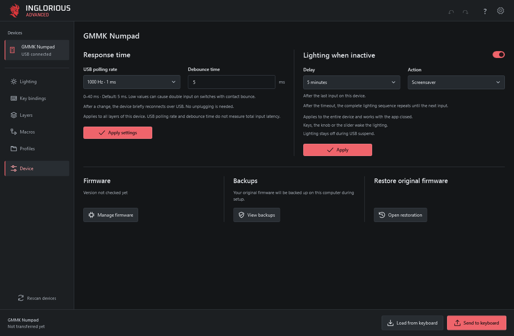
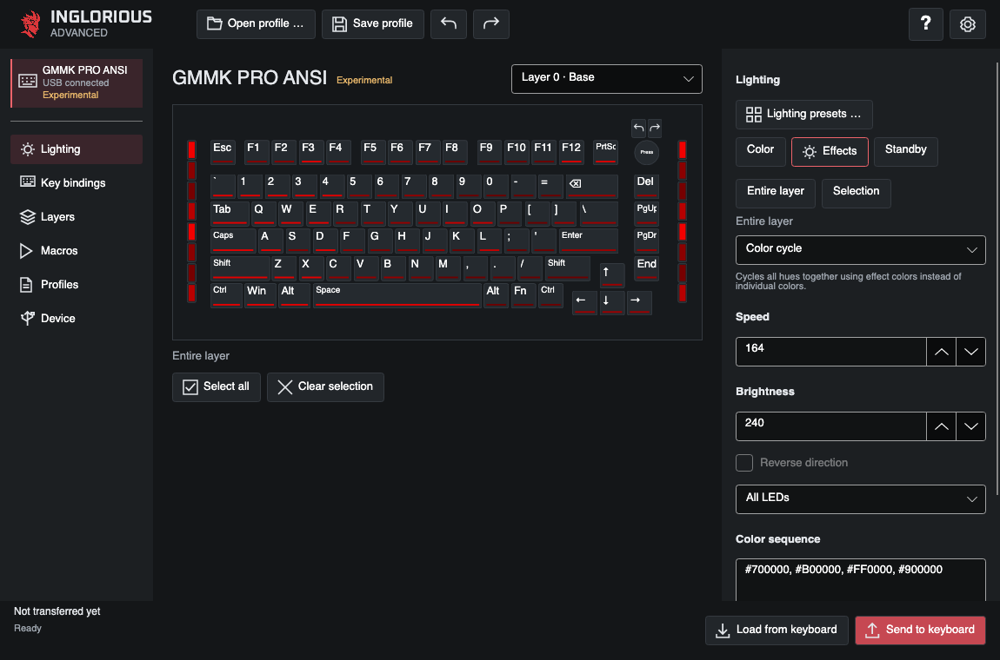
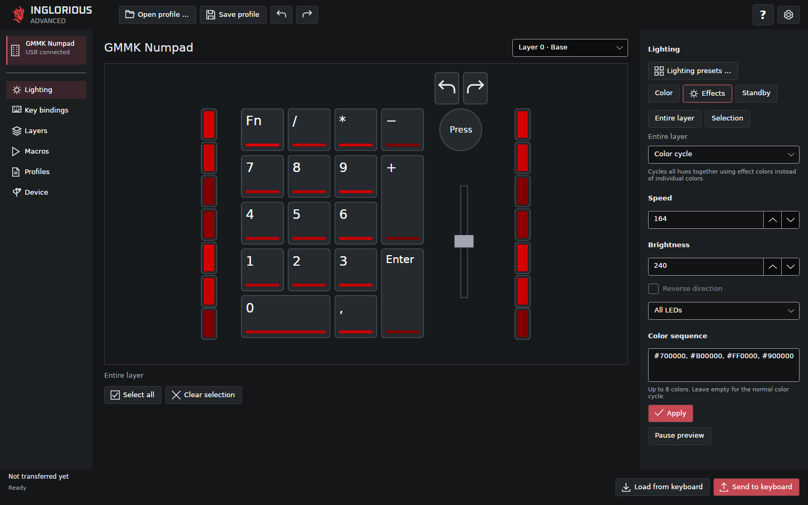

# INGLORIOUS Advanced

**[Download](https://github.com/LatroX-dev/INGLORIOUS-Advanced/releases/latest) · [Setup & recovery](docs/getting-started.md) · [Supported keyboards](docs/model-support.md) · [Changelog](CHANGELOG.md) · [Help](SUPPORT.md)**

Configure Glorious keyboards with per-key lighting, effects, key assignments, macros and four layers. Settings run on the keyboard after transfer, so the app can be closed.

I love Glorious hardware. I built INGLORIOUS Advanced to help everyone get the most out of it, as easily as possible.

**App 0.7.0 · Firmware 0.11.11 for GMMK 3 PRO 100% ISO; 0.11.9 for other supported models**

Get installers and packages from the [Releases page](https://github.com/LatroX-dev/INGLORIOUS-Advanced/releases). macOS and Linux builds are Early Alpha; physical-device testing is still limited.

See the [Changelog](CHANGELOG.md) for new features, improvements and bug fixes.

INGLORIOUS Advanced is an independent project. It is not affiliated with or endorsed by Glorious. Product names identify compatible hardware.

## Demo

https://github.com/user-attachments/assets/5097bc01-0c87-4f6c-bcde-ef262cdd0d00

Select keys, change their color, choose an effect and transfer the configuration to a GMMK PRO ISO. Recorded in the Windows app.

**[Download the video](https://github.com/LatroX-dev/INGLORIOUS-Advanced/releases/download/v0.6.57/INGLORIOUS-Advanced-Demo-en.mp4)** · [English captions](docs/demo/INGLORIOUS-Advanced-Demo-en.srt) · [Music credits](docs/demo/README.md)

## Get started

1. Download the installer or package for your operating system from this repository's Releases page.
2. On Windows, run **INGLORIOUS-Advanced-\<version\>-win-x64-Setup.exe**. On macOS, extract the package and move **INGLORIOUS Advanced.app** to Applications. On Linux, extract the package and open **application/INGLORIOUS Advanced**; the [setup guide](docs/getting-started.md) explains USB permissions.
3. Connect a supported keyboard by USB. The app loads an existing INGLORIOUS configuration automatically. For original firmware, open **Settings → Devices & data → Set up device** and follow the guide.
4. Make your changes and select **Send to keyboard** at the bottom.

The packages include the runtime and the matching firmware for all supported models; you do not need to install .NET separately or download firmware files. Firmware installation is a separate, explicitly confirmed step. Keep the cable connected and INGLORIOUS Advanced open while firmware is being written.

Read the [setup and recovery guide](docs/getting-started.md). The **?** button opens offline help in your selected language.

## Keyboard support

| Model | Layouts | Status |
| --- | --- | --- |
| GMMK PRO, revision 1 | ISO | Used on physical hardware |
| GMMK Numpad | **USB only — Bluetooth does not work** | Used on physical hardware |
| GMMK PRO, revision 1 | ANSI | Experimental |
| GMMK PRO, revision 2 | ANSI, ISO | Experimental |
| GMMK 2, 65% and 96% | ANSI, ISO | Experimental |
| GMMK 3, wired non-HE, 65%, 75% and 100% | ANSI, ISO | Experimental |
| GMMK 3 PRO, wired non-HE, 100% | ISO | Hardware tested on Windows |

There are **16 model/layout variants**, including **13 experimental variants**. Experimental devices can be configured and installed; their physical testing is still pending. On one GMMK 3 PRO 100% ISO, Windows testing covers installation, typing and lighting, original-firmware recovery, the full lighting test, the OS switch, and independent profile switching with the app closed and after reconnecting. Automatic loading and configuration transfer were also confirmed with app 0.7.0. This status applies only to the wired, non-HE 100% ISO variant. The Numpad's original-firmware recovery, first installation, automatic reconnection, lighting sequence and typing test have been used on Windows with app 0.6.43. See the [hardware acceptance checklist](docs/hardware-acceptance.md) for the remaining tests.

GMMK 3 PRO support is limited to the **100% ISO wired, non-HE variant**. Other PRO sizes and layouts, GMMK HE, GMBK, GMMK Eternal, Bluetooth and other wireless modes are not supported. Check the [complete model list](docs/model-support.md) before installing firmware.

### ANSI layouts

**GMMK PRO ANSI — key bindings**

**GMMK 3 100% ANSI — key bindings**

These screenshots show the Windows editor with offline demo data. They do not demonstrate a hardware test.

## Features

- Per-key and side lighting, 21 effects, custom color sequences and animated previews.
- Shared color favorites, lighting templates and import/export.
- Key and encoder assignments, four layers and a shared macro library with import/export.
- Import and export key bindings for selected layers, including assigned macros, without changing lighting. The Numpad slider can be included separately.
- Local profiles for each device, with configuration readback after transfer.
- Three independent onboard profiles selected by the physical switch on the GMMK 3 PRO 100% ISO. [Status for other models](docs/model-support.md#physical-switches).
- Windows/macOS modifier switching via the physical switch on supported GMMK 3 wired models (ANSI and ISO), without using an extra layer.
- Adjustable USB polling rate and debounce time.
- Standby lighting and an optional INGLORIOUS screensaver, under Device.
- Numpad slider: disabled, lighting brightness, relative volume or MIDI control.
- Guided firmware setup, update and original-firmware recovery on Windows, macOS and Linux.
- Software update notifications and verified downloads from GitHub.

Switch the global lighting effect off to show stored colors while keeping individual LED effects. Use **Device** for response time, lighting during inactivity, firmware and backups.

Ordinary configuration changes do not require a firmware update. Shared dimming between devices is optional and needs the app running. The Numpad's own dimmer works without the app. Lighting colors are previews, not calibrated measurements of the LEDs.

The app follows the system language by default, with English as fallback. It includes German, English, Spanish, French, Italian, Brazilian Portuguese, Polish, Turkish, Russian, Japanese, Korean and Simplified Chinese.

### App updates

Open **Settings → Updates** to check for a new version or turn automatic checks on or off. Automatic checks run at startup and every twelve hours. Downloading and installing an update always requires your action. On Windows, the app opens the normal installer after handling unsaved changes. On macOS and Linux, it downloads the package and shows how to replace the app. Profiles and original-firmware backups are kept.

New firmware comes with app updates when available. Updating the app does not flash a keyboard; the device guide handles firmware changes separately.

## Custom firmware built on QMK

INGLORIOUS uses custom firmware developed for this project and built on [QMK Firmware](https://qmk.fm/). Each supported model receives its own INGLORIOUS build, combining QMK's keyboard and hardware support with our app connection, onboard configuration, lighting effects, macro handling, standby and screensaver features.

The resulting firmware replaces the keyboard's original firmware. Your original backup remains available for recovery. GMMK 3 support also uses adapted open-source keyboard definitions published by Glorious.

**Thanks to the QMK community and the upstream contributors who make this possible.**

The desktop app is developed as part of INGLORIOUS Advanced. See the [firmware documentation](firmware/README.md) for source details and [third-party notices](THIRD-PARTY-NOTICES.md) for credits and licenses.

## Original firmware and backups

**Use this software and its firmware at your own risk.** Firmware changes can cause data loss or leave a device unusable. Keep a separate copy of your original-firmware backups.

Before first installation, the app creates and checks two copies of the keyboard's internal original firmware. Keep the backup folder: it is needed to return to the original firmware through **Settings → Devices & data → Restore original firmware**.

This backup does not include external profile memory, wireless modules or protection settings. Original application settings are therefore not guaranteed to return exactly as before. A disconnected cable or loss of power during a firmware write can require separate recovery. The app stops if it cannot identify the device or verify a backup.

**Lost your backup files?** Glorious provides separate recovery guides with original firmware downloads:

- [GMMK PRO — restore Glorious CORE firmware](https://glorious.ladesk.com/385785-GMMK-PRO---Reverting-to-default-Glorious-CORE-Firmware)
- [GMMK Numpad — restore Glorious CORE firmware](https://glorious.ladesk.com/969914-GMMK-Numpad---Reverting-back-to-Glorious-CORE-firmware)
- [GMMK 2 — restore Glorious CORE firmware](https://glorious.ladesk.com/858378-GMMK-2-Reverting-Keyboard-to-default-Firmware-Glorious-Core)

Use the firmware for your exact model, layout and hardware revision. For GMMK 3 or a revision not listed in these guides, contact [Glorious Support](https://www.gloriousgaming.com/en-uk/pages/contact) for the matching recovery firmware.

## Platforms

| Platform | Availability |
| --- | --- |
| Windows x64 | Main WPF app, configuration and guided firmware management |
| Windows 11 ARM64 | No native package; the x64 build has not been tested under emulation |
| macOS, Intel and Apple Silicon | Early Alpha; native builds, packages and offline checks passed; physical-device testing pending |
| Linux x64 | Early Alpha; native build, package and offline checks passed; physical-device testing pending |

Physical-device checks for macOS and Linux are still pending. Windows packages are unsigned; macOS packages use ad-hoc signing and are not Apple notarized.

### macOS and Linux — Early Alpha

**macOS — GMMK PRO ANSI**

**Linux — GMMK Numpad**

These screenshots were captured on native macOS and Linux runners using synthetic profiles. Both platforms are **Early Alpha**; the screenshots show the app and do not demonstrate a physical-device test. [Capture details](docs/images/native-provenance.json).

## Contact and feedback

See [Help & support](SUPPORT.md) for setup questions, bug reports and feature requests. Feedback from owners of supported keyboards helps improve the app and its device support.

Use **Device → Feedback & contact** to preview a voluntary report and open it on GitHub or in your email app. Nothing is submitted automatically. GitHub reports are public; do not include personal data or backup files.

Public contact: [inglorious@latrox.dev](mailto:inglorious@latrox.dev).

## Support the project

If INGLORIOUS Advanced is useful to you, you can [support its development on Ko-fi](https://ko-fi.com/latrox). Donations are optional; the app and firmware remain free and open source.

A [GitHub star](https://github.com/LatroX-dev/INGLORIOUS-Advanced/stargazers), a hardware report or a [contribution](CONTRIBUTING.md) also helps.

### Star history

<a href="https://www.star-history.com/?repos=LatroX-dev%2FINGLORIOUS-Advanced&type=date&legend=top-left">
  <picture>
    <source media="(prefers-color-scheme: dark)" srcset="https://api.star-history.com/chart?repos=LatroX-dev/INGLORIOUS-Advanced&type=date&theme=dark&legend=top-left" />
    
  </picture>
</a>

## Build and contribute

See [CONTRIBUTING.md](CONTRIBUTING.md) for the clean build, offline checks and contribution scope. [Release preparation](docs/public-release.md) covers packaging and corresponding source; [firmware documentation](firmware/README.md) contains the device protocol and build details.

Please use the issue templates for bugs, feature requests and reports from additional hardware. Do not attach original firmware, personal profiles or unredacted diagnostic logs. Report vulnerabilities as described in [SECURITY.md](SECURITY.md).

## License

The desktop application, adapter and original project tooling are **GPL-3.0-or-later**. Firmware and imported sources retain their own licenses. See [COPYRIGHT.md](COPYRIGHT.md), [LICENSE](LICENSE) and [third-party notices](THIRD-PARTY-NOTICES.md). Release downloads must be accompanied by the matching source package.
