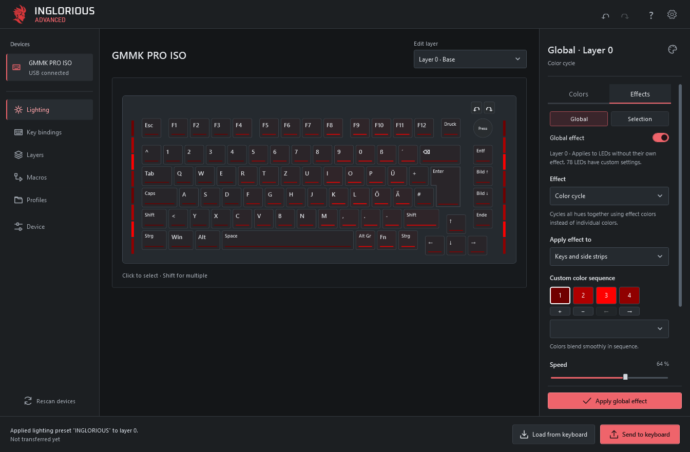
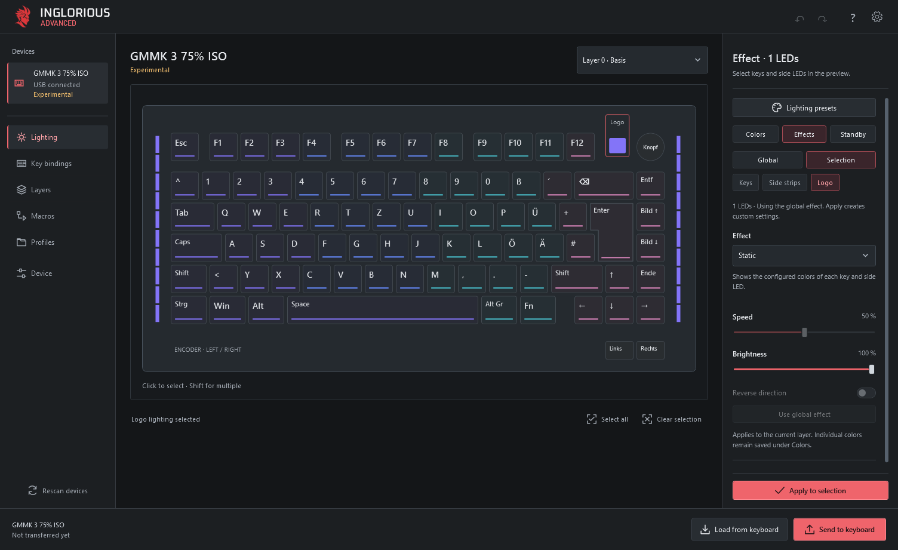
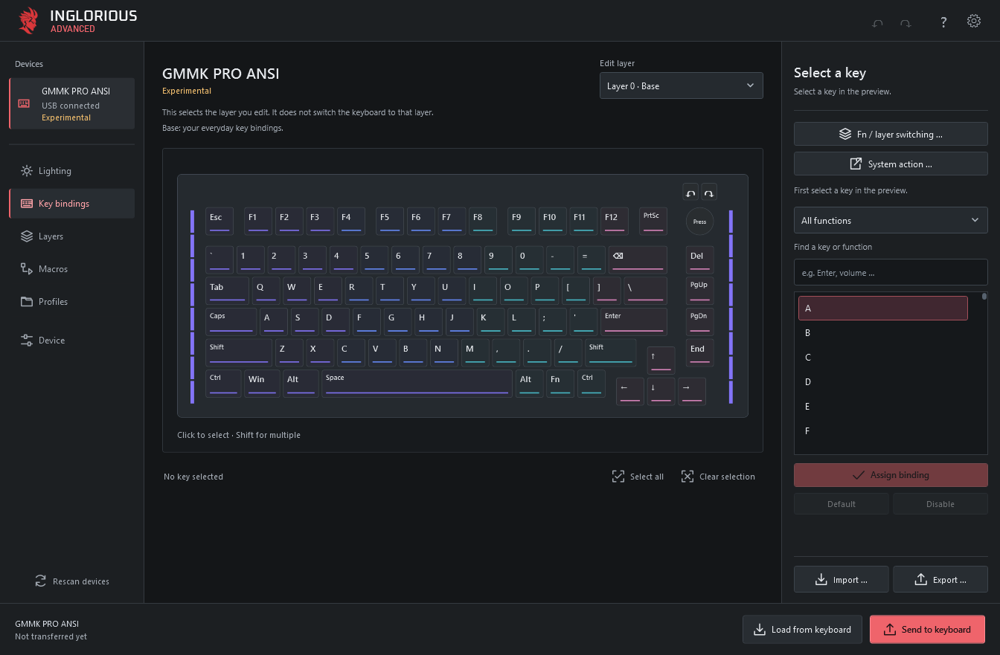
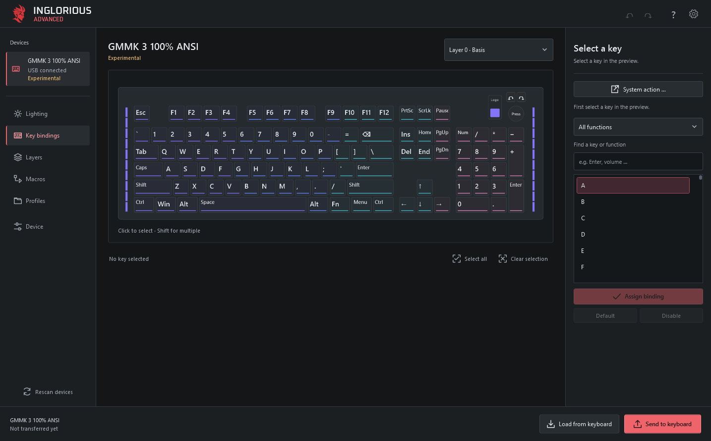

# INGLORIOUS Advanced

Configure Glorious keyboards with per-key lighting, effects, key assignments, macros and four layers. Settings run on the keyboard after transfer, so the app can be closed.

I love Glorious hardware. I built INGLORIOUS Advanced to help everyone get the most out of it, as easily as possible.

**Source preview · App 0.6.45 · Firmware 0.11.0**

Public downloads are not available yet. Release and hardware checks are still in progress.

INGLORIOUS Advanced is an independent project. It is not affiliated with or endorsed by Glorious. Product names identify compatible hardware.

## Get started

For now, use the [source build instructions](docs/public-release.md). Once downloads are available:

1. Download the installer or package for your operating system from this repository's Releases page.
2. On Windows, run **INGLORIOUS-Advanced-\<version\>-Setup.exe**. On macOS, extract the package and move **INGLORIOUS Advanced.app** to Applications. On Linux, extract the package and open **application/INGLORIOUS Advanced**; the [setup guide](docs/getting-started.md) explains USB permissions.
3. Connect a supported keyboard by USB. The app loads an existing INGLORIOUS configuration automatically. For original firmware, open **Settings → Set up device** and follow the guide.
4. Make your changes and select **Send to keyboard** at the bottom.

The packages include the runtime and the matching firmware for all supported models; you do not need to install .NET separately or download firmware files. Firmware installation is a separate, explicitly confirmed step. Keep the cable connected and INGLORIOUS Advanced open while firmware is being written.

Read the [setup and recovery guide](docs/getting-started.md). The **?** button opens offline help in your selected language.

## Keyboard support

| Model | Layouts | Status |
| --- | --- | --- |
| GMMK PRO, revision 1 | ISO | Used on physical hardware |
| GMMK Numpad | **USB only — Bluetooth does not work** | Used on physical hardware |
| GMMK PRO, revision 1 | ANSI | Experimental |
| GMMK PRO, revision 2 | ANSI, ISO | Experimental |
| GMMK 2, 65% and 96% | ANSI, ISO | Experimental |
| GMMK 3, wired non-HE, 65%, 75% and 100% | ANSI, ISO | Experimental |

There are **15 model/layout variants**, including **13 experimental variants**. Experimental devices can be configured and installed, but have not been tested on physical hardware. The Numpad's original-firmware recovery, first installation, automatic reconnection, lighting sequence and typing test have been used on Windows with app 0.6.43. The complete [hardware acceptance checklist](docs/hardware-acceptance.md) is still in progress.

GMMK 3 PRO is not automatically treated as a supported GMMK 3. GMMK HE, GMBK, GMMK Eternal, Bluetooth and other wireless modes are not supported. Check the [complete model list](docs/model-support.md) before installing firmware.

### ANSI layouts

**GMMK PRO ANSI — key bindings**

**GMMK 3 100% ANSI — key bindings**

These screenshots show the Windows editor with offline demo data. They do not demonstrate a hardware test.

## Features

- Per-key and side lighting, 21 effects, custom color sequences and animated previews.
- Shared color favorites, lighting templates and import/export.
- Key and encoder assignments, four layers and a shared macro library with import/export.
- Local profiles for each device, with configuration readback after transfer.
- Adjustable USB polling rate and debounce time.
- Standby lighting and an optional INGLORIOUS screensaver.
- Numpad slider: disabled, lighting brightness, relative volume or MIDI control.
- Guided firmware setup, update and original-firmware recovery on Windows, macOS and Linux.

Ordinary configuration changes do not require a firmware update. Shared dimming between devices is optional and needs the app running. The Numpad's own dimmer works without the app. Lighting colors are previews, not calibrated measurements of the LEDs.

The app follows the system language by default, with English as fallback. It includes German, English, Spanish, French, Italian, Brazilian Portuguese, Polish, Turkish, Russian, Japanese, Korean and Simplified Chinese.

## Custom firmware built on QMK

INGLORIOUS uses custom firmware developed for this project and built on [QMK Firmware](https://qmk.fm/). Each supported model receives its own INGLORIOUS build, combining QMK's keyboard and hardware support with our app connection, onboard configuration, lighting effects, macro handling, standby and screensaver features.

The resulting firmware replaces the keyboard's original firmware. Your original backup remains available for recovery. GMMK 3 support also uses adapted open-source keyboard definitions published by Glorious.

**Thanks to the QMK community and the upstream contributors who make this possible.**

The desktop app is developed as part of INGLORIOUS Advanced. See the [firmware documentation](firmware/README.md) for source details and [third-party notices](THIRD-PARTY-NOTICES.md) for credits and licenses.

## Original firmware and backups

**Use this software and its firmware at your own risk.** Firmware changes can cause data loss or leave a device unusable. Keep a separate copy of your original-firmware backups.

Before first installation, the app creates and checks two copies of the keyboard's internal original firmware. Keep the backup folder: it is needed to return to the original firmware through **Settings → Restore original firmware**.

This backup does not include external profile memory, wireless modules or protection settings. Original application settings are therefore not guaranteed to return exactly as before. A disconnected cable or loss of power during a firmware write can require separate recovery. The app stops if it cannot identify the device or verify a backup.

**Lost your backup files?** Glorious provides separate recovery guides with original firmware downloads:

- [GMMK PRO — restore Glorious CORE firmware](https://glorious.ladesk.com/385785-GMMK-PRO---Reverting-to-default-Glorious-CORE-Firmware)
- [GMMK Numpad — restore Glorious CORE firmware](https://glorious.ladesk.com/969914-GMMK-Numpad---Reverting-back-to-Glorious-CORE-firmware)
- [GMMK 2 — restore Glorious CORE firmware](https://glorious.ladesk.com/858378-GMMK-2-Reverting-Keyboard-to-default-Firmware-Glorious-Core)

Use the firmware for your exact model, layout and hardware revision. For GMMK 3 or a revision not listed in these guides, contact [Glorious Support](https://www.gloriousgaming.com/en-uk/pages/contact) for the matching recovery firmware.

## Platforms

| Platform | Availability |
| --- | --- |
| Windows x64 | Main WPF app, configuration and guided firmware management |
| Windows 11 ARM64 | No native package; the x64 build has not been tested under emulation |
| macOS, Intel and Apple Silicon | Avalonia app with configuration and guided firmware management; native validation pending |
| Linux x64 | Avalonia app with configuration and guided firmware management; native validation pending |

Native package and hardware checks for macOS and Linux are still pending. Windows packages are unsigned; macOS packages use ad-hoc signing and are not Apple notarized.

### macOS and Linux — Early Alpha

Native builds are in progress. The build jobs capture lighting views on macOS and Linux with synthetic profiles. Those screenshots will appear here after visual review; the images above show the Windows app.

## Build and contribute

See [CONTRIBUTING.md](CONTRIBUTING.md) for the clean build, offline checks and contribution scope. [Release preparation](docs/public-release.md) covers packaging and corresponding source; [firmware documentation](firmware/README.md) contains the device protocol and build details.

Please use the issue templates for bugs, feature requests and reports from additional hardware. Do not attach original firmware, personal profiles or unredacted diagnostic logs. Report vulnerabilities as described in [SECURITY.md](SECURITY.md).

## License

The desktop application, adapter and original project tooling are **GPL-3.0-or-later**. Firmware and imported sources retain their own licenses. See [COPYRIGHT.md](COPYRIGHT.md), [LICENSE](LICENSE) and [third-party notices](THIRD-PARTY-NOTICES.md). Release downloads must be accompanied by the matching source package.
